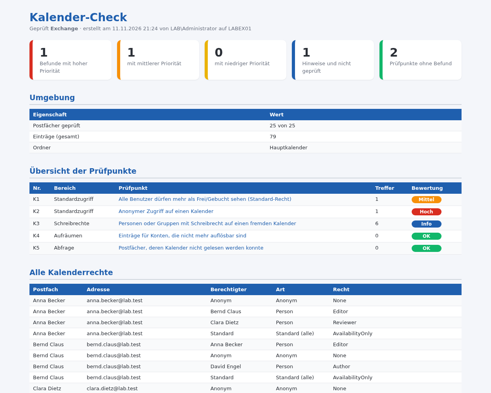

# Kalender-Check – wer darf in Exchange auf welchen Kalender zugreifen?

Kostenloses PowerShell-Skript: liest die Berechtigungen des **Hauptkalenders aller Benutzer-, Gemeinsamen, Raum- und Gerätepostfächer** einer lokalen Exchange-Organisation aus und zeigt, **wer wo welches Recht hat**. Zusätzlich meldet es einige Auffälligkeiten (Standard-Recht zu weit, anonymer Zugriff, Schreibrechte). Ergebnis ist ein übersichtlicher **HTML-Bericht auf Deutsch oder Englisch** (`-Language de|en`, Standard je nach Windows-Sprache). Das Skript arbeitet **ausschließlich lesend**: Es verwendet nur Get-Befehle von Exchange, ändert nichts und überträgt keine Daten.



Der gezeigte Bericht stammt aus einer Testumgebung. Das vollständige Beispiel liegt als [Beispielbericht.html](Beispielbericht.html) bei.

## Was geprüft wird

| Nr. | Bereich | Prüfpunkt |
|---|---|---|
| K1 | Standardzugriff | Alle Benutzer dürfen mehr als Frei/Gebucht sehen (Standard-Recht über „AvailabilityOnly“) |
| K2 | Standardzugriff | Anonymer Zugriff auf einen Kalender |
| K3 | Schreibrechte | Personen oder Gruppen mit Schreibrecht auf einen fremden Kalender (auch „NonEditingAuthor“ und „Contributor“ zählen dazu) |
| K4 | Aufräumen | Einträge für Konten, die nicht mehr auflösbar sind |
| K5 | Abfrage | Postfächer, deren Kalender nicht gelesen werden konnte (stehen als „nicht geprüft“ im Bericht) |

Dazu gibt es die Liste **aller Kalenderrechte**: Postfach, Berechtigter, Art (Person, Gruppe, Standard, Anonym) und Recht. Jeder Befund kommt mit Erklärung und Empfehlung.

## Start

Direkt auf einem Exchange-Server (das Skript lädt die Exchange-Verwaltungsshell selbst):

```powershell
powershell -ExecutionPolicy Bypass -File .\Kalender-Check.ps1
```

Von einem anderen Rechner aus über eine Remote-Sitzung, mit CSV-Ausgabe:

```powershell
.\Kalender-Check.ps1 -ExchangeServer ex01.firma.local -Csv -Ausgabe C:\Berichte\kalender.html
```

Optionen: `-Postfach <Adressen>` (nur diese Postfächer, auch als Kommaliste; ein unbekanntes Postfach erscheint unter K5), `-ExchangeServer <Name>`, `-Csv`, `-Ausgabe <Pfad>`, `-NichtOeffnen`, `-PassThru`. Alle Optionen zeigt `Get-Help .\Kalender-Check.ps1 -Detailed`. Ohne `-Ausgabe` landet der Bericht im aktuellen Ordner (`Kalender-Check_Exchange_<Datum>.html`). CSV-Dateien sind mit Semikolon getrennt und UTF-8 mit BOM.

**Voraussetzungen:** Windows PowerShell 5.1, Exchange Server 2016/2019/SE (lokal installiert, nicht Exchange Online). Zum Lesen genügt die Rolle „View-Only Recipients“, z. B. über „View-Only Organization Management“.

## Was das Skript sieht und was nicht

- Gelesen wird der **Hauptkalender**. „Gelöschte Elemente“, weitere Kalender und Unterordner sowie die Postfachrechte „Vollzugriff“ und „Senden als“ gehören nicht dazu.
- Gruppen in den Berechtigungen werden als Gruppe angezeigt, aber **nicht in ihre Mitglieder aufgelöst**.
- Das Skript liest nacheinander und braucht grob eine Sekunde je Postfach (200 Postfächer: einige Minuten). Der Ordner wird über den Ordnertyp gesucht, deshalb funktioniert es in jeder Postfachsprache.
- Getestet mit Windows PowerShell 5.1 und Exchange Server SE (15.2) unter Windows Server 2025 in zwei voneinander unabhängigen Testumgebungen mit deutschen, englischen, französischen und italienischen Postfächern: K1 bis K5 wurden mit nachgestellten Fällen ausgelöst, ebenso die Rolle „View-Only Recipients“ als einziges Recht. Die Remote-Sitzung (`-ExchangeServer`) verwendet Kerberos über http (einen https-Weg gibt es nicht). Nicht getestet: Exchange 2016/2019, mehrere Exchange-Server.

## Vollversion

Dieses Skript ist ein eigenständiger, kostenloser Ausschnitt. Der **Exchange-Kalenderrechte-Bericht** im Shop geht deutlich weiter:

- Liest zusätzlich den Ordner **„Gelöschte Elemente“** und zeigt, wo Stellvertreter Termine nicht löschen können
- **Löst Gruppen in Mitglieder auf**, erkennt **Mehrfach-Einträge** (direkt und über Gruppen, mit gleichem oder unterschiedlichem Recht) und **schlägt Sicherheitsgruppen vor**, wenn dieselben Personen an vielen Kalendern dasselbe Recht haben
- Liest in mehreren Exchange-Sitzungen gleichzeitig (deutlich schneller)
- Interaktiver Bericht mit Matrix, Filtern und CSV-Ausgabe; Änderungen lassen sich im Bericht sammeln und als **prüfbares PowerShell-Skript** (mit Testlauf `-WhatIf`) ausgeben

➜ **[IT Admin Tools by MM auf Etsy](https://www.etsy.com/shop/ITAdminToolsbyMM)** · **[auf Gumroad](https://mueller86.gumroad.com)**

Kostenlos auf GitHub:

- [AD-Schnellcheck](https://github.com/jackyno7/ad-schnellcheck) (8 Prüfpunkte zur Domäne)
- [Zertifikate-Bericht](https://github.com/jackyno7/zertifikate-bericht) (abgelaufene und bald ablaufende Zertifikate)
- [Privilegierte-Konten-Check](https://github.com/jackyno7/privilegierte-konten-check) (7 Prüfpunkte zu Administratorkonten)

<!-- querverweis:anfang -->
## Alle Skripte und Vorlagen

Übersicht aller Prüfskripte und Vorlagen: **[github.com/jackyno7](https://github.com/jackyno7)**

Vollversionen:

- Active Directory Prüfbericht: [Etsy](https://www.etsy.com/listing/4588853943) · [Gumroad](https://mueller86.gumroad.com/l/fcneoc)
- Domänencontroller-Gesundheitsbericht: [Etsy](https://www.etsy.com/listing/4593087246) · [Gumroad](https://mueller86.gumroad.com/l/bseljr)
- DNS- und DHCP-Bericht: [Etsy](https://www.etsy.com/listing/4593096270) · [Gumroad](https://mueller86.gumroad.com/l/sthgh)
- Kerberos- und Altlasten-Check: [Etsy](https://www.etsy.com/listing/4593092377) · [Gumroad](https://mueller86.gumroad.com/l/zptvct)
- Berechtigungsbericht Active Directory: [Etsy](https://www.etsy.com/listing/4593113568) · [Gumroad](https://mueller86.gumroad.com/l/xyjmdr)
- GPO-Bericht: [Etsy](https://www.etsy.com/listing/4593129111) · [Gumroad](https://mueller86.gumroad.com/l/wdosl)
- Anmelde- und Sperrbericht: [Etsy](https://www.etsy.com/listing/4593157082) · [Gumroad](https://mueller86.gumroad.com/l/ztktaaq)
- Rechner-Inventar aus Active Directory: [Etsy](https://www.etsy.com/listing/4593088535) · [Gumroad](https://mueller86.gumroad.com/l/zzycdd)
- Dateiserver-Bericht: [Etsy](https://www.etsy.com/listing/4612420692) · [Gumroad](https://mueller86.gumroad.com/l/wbbwj)
- Dateiserver-Rechte-Bericht: [Etsy](https://www.etsy.com/listing/4616706194) · [Gumroad](https://mueller86.gumroad.com/l/ijrkb)
- Windows-Rechnerbericht: [Etsy](https://www.etsy.com/listing/4616020701) · [Gumroad](https://mueller86.gumroad.com/l/wmhfk)
- Exchange-Postfachbericht: [Etsy](https://www.etsy.com/listing/4614916333) · [Gumroad](https://mueller86.gumroad.com/l/gkdllj)
- Exchange-Kalenderrechte-Bericht: [Etsy](https://www.etsy.com/listing/4614799790) · [Gumroad](https://mueller86.gumroad.com/l/iabfb)
- Exchange-Nachrichtenverfolgung: [Etsy](https://www.etsy.com/listing/4614785975) · [Gumroad](https://mueller86.gumroad.com/l/msria)
- Active Directory Prüfskript-Paket: [Etsy](https://www.etsy.com/listing/4611942401) · [Gumroad](https://mueller86.gumroad.com/l/awzjtc)

Vorlagen und Checklisten (Notfallplan, Backup, Passwortrichtlinie, Onboarding, Homeoffice, Netzwerk-Dokumentation): [Etsy](https://www.etsy.com/shop/ITAdminToolsbyMM) · [Gumroad](https://mueller86.gumroad.com)
<!-- querverweis:ende -->

## Hinweise

- Der Bericht enthält Namen und Adressen von Postfächern und Berechtigten – bitte vertraulich behandeln und vor dem Einsatz klären, ob die Auswertung im eigenen Unternehmen zulässig ist.
- Der Bericht zeigt Auffälligkeiten anhand fester Regeln. Er ersetzt kein Berechtigungskonzept und erhebt keinen Anspruch auf Vollständigkeit.
- Nutzung auf eigene Verantwortung, siehe [LICENSE](LICENSE).
- Bei der Ausarbeitung wurden KI-Werkzeuge unterstützend eingesetzt; Inhalte und Skript wurden fachlich geprüft und im Testlab getestet.

---

### English

Free, read-only PowerShell script for on-premises Exchange Server that lists who has which permission on the main calendar of every mailbox and flags a few findings (default permission too wide, anonymous access, write permissions, unresolvable entries). HTML report in German or English (`-Language de|en`) with explanations and recommendations. Nothing is changed and no data leaves the machine. Run: `powershell -ExecutionPolicy Bypass -File .\Kalender-Check.ps1`. The paid report adds Deleted Items checks, group resolution, duplicate detection, group suggestions and a generated change script.

<!-- querverweis-en:anfang -->
#### All scripts and templates

Overview of all check scripts and templates: **[github.com/jackyno7](https://github.com/jackyno7)**

Full versions:

- Active Directory Audit Report: [Etsy](https://www.etsy.com/listing/4588853943) · [Gumroad](https://mueller86.gumroad.com/l/fcneoc)
- Domain Controller Health Report: [Etsy](https://www.etsy.com/listing/4593087246) · [Gumroad](https://mueller86.gumroad.com/l/bseljr)
- DNS and DHCP Report: [Etsy](https://www.etsy.com/listing/4593096270) · [Gumroad](https://mueller86.gumroad.com/l/sthgh)
- Kerberos and Legacy Check: [Etsy](https://www.etsy.com/listing/4593092377) · [Gumroad](https://mueller86.gumroad.com/l/zptvct)
- Active Directory Permissions Report: [Etsy](https://www.etsy.com/listing/4593113568) · [Gumroad](https://mueller86.gumroad.com/l/xyjmdr)
- GPO Report: [Etsy](https://www.etsy.com/listing/4593129111) · [Gumroad](https://mueller86.gumroad.com/l/wdosl)
- Logon and Lockout Report: [Etsy](https://www.etsy.com/listing/4593157082) · [Gumroad](https://mueller86.gumroad.com/l/ztktaaq)
- Computer Inventory from Active Directory: [Etsy](https://www.etsy.com/listing/4593088535) · [Gumroad](https://mueller86.gumroad.com/l/zzycdd)
- File Server Report: [Etsy](https://www.etsy.com/listing/4612420692) · [Gumroad](https://mueller86.gumroad.com/l/wbbwj)
- File Server Permissions Report: [Etsy](https://www.etsy.com/listing/4616706194) · [Gumroad](https://mueller86.gumroad.com/l/ijrkb)
- Windows Computer Report: [Etsy](https://www.etsy.com/listing/4616020701) · [Gumroad](https://mueller86.gumroad.com/l/wmhfk)
- Exchange Mailbox Report: [Etsy](https://www.etsy.com/listing/4614916333) · [Gumroad](https://mueller86.gumroad.com/l/gkdllj)
- Exchange Calendar Permissions Report: [Etsy](https://www.etsy.com/listing/4614799790) · [Gumroad](https://mueller86.gumroad.com/l/iabfb)
- Exchange Message Tracking: [Etsy](https://www.etsy.com/listing/4614785975) · [Gumroad](https://mueller86.gumroad.com/l/msria)
- Active Directory Check Script Bundle: [Etsy](https://www.etsy.com/listing/4611942401) · [Gumroad](https://mueller86.gumroad.com/l/awzjtc)

Templates and checklists (emergency plan, backup, password policy, onboarding, home office, network documentation): [Etsy](https://www.etsy.com/shop/ITAdminToolsbyMM) · [Gumroad](https://mueller86.gumroad.com)
<!-- querverweis-en:ende -->
